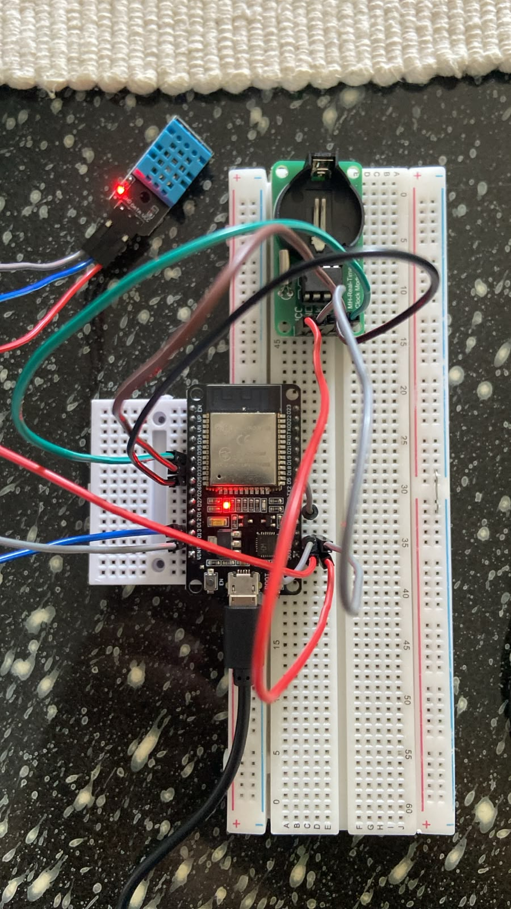
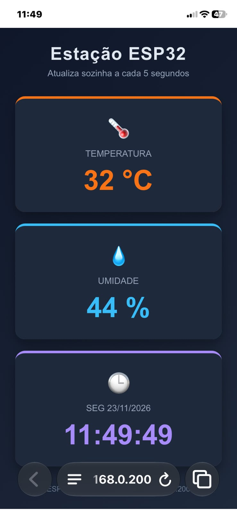

# Estação Web com ESP32

Estação de monitoramento que lê **temperatura e umidade** (DHT11), mantém **data e hora** num relógio de tempo real (DS1302) acertado **pela internet (NTP)** e publica tudo numa **página web responsiva** servida pelo próprio ESP32, acessível do PC ou do celular na rede local.

<p align="center">
  
</p>

<p align="center">
  
  &nbsp;&nbsp;
  
</p>

---

## Funcionalidades

- Servidor web HTTP rodando **no próprio ESP32** (sem servidor externo)
- Leitura de temperatura e umidade **no momento de cada visita**
- Hora certa obtida via **NTP** (`pool.ntp.br`) com ajuste de fuso (UTC−3) e gravada no **DS1302**
- Página que **se atualiza sozinha** a cada 5 segundos
- Layout **responsivo** com CSS Grid: cartões lado a lado no PC e empilhados no celular
- Credenciais de Wi-Fi isoladas no `config.py` (fora do repositório)

## Hardware e ferramentas

| Item | Detalhe |
|---|---|
| Placa | ESP32 DevKit (ESP-WROOM-32, 30 pinos) |
| Firmware | MicroPython 1.29 |
| IDE | Thonny |
| Terminal | `mpremote` (Linux) |

## Componentes

| Componente | Função |
|---|---|
| ESP32 DevKit | Microcontrolador com Wi-Fi |
| DHT11 | Sensor de temperatura e umidade |
| DS1302 | Relógio de tempo real (RTC) |
| Protoboard e jumpers | Montagem |

## Ligações

| Componente | Pino do componente | ESP32 |
|---|---|---|
| DHT11 | S (DATA) | D13 |
| DHT11 | + (VCC) | 3V3 |
| DHT11 | − (GND) | GND |
| DS1302 | VCC | 3V3 |
| DS1302 | GND | GND |
| DS1302 | CLK | D25 |
| DS1302 | DAT | D33 |
| DS1302 | RST | D32 |

## Como funciona

```
Navegador ──GET /──▶ ESP32 (porta 80) ──▶ lê DHT11 + DS1302 ──▶ monta o HTML ──▶ resposta HTTP
```

1. Ao ligar, o ESP32 conecta no Wi-Fi com **IP fixo**.
2. Pergunta a hora a um servidor **NTP**, converte para o horário local e **grava no DS1302**.
3. Abre um **socket na porta 80** e espera visitas.
4. A cada visita, lê o sensor e o relógio, preenche o modelo HTML e devolve a página.

## Passo a passo do desenvolvimento

O projeto foi construído em etapas, cada uma com seu próprio teste:

| Ordem | Arquivo | O que valida |
|---|---|---|
| 1 | `teste_wifi.py` | Conexão Wi-Fi com IP fixo |
| 2 | `servidor_ola.py` | Primeiro servidor web com página fixa |
| 3 | `teste_dht.py` | Leitura do sensor DHT11 no Shell |
| 4 | `teste_ntp.py` | Hora exata via NTP com fuso horário |
| 5 | `teste_ntp_ds1302.py` | Hora do NTP gravada e lida no DS1302 |
| 6 | `estacao_web.py` | **Programa final**: tudo junto, com CSS |

O arquivo `ds1302.py` é o **driver próprio** do relógio (protocolo de 3 fios e formato BCD), usado pelos passos 5 e 6.

## Como rodar

1. Copie `config.exemplo.py` para `config.py`, preencha com os dados da sua rede e salve **dentro da placa**.
2. Salve `ds1302.py` **dentro da placa**.
3. Abra `estacao_web.py` no **Thonny** e execute (F5), ou pelo terminal:
   ```bash
   mpremote connect /dev/ttyACM0 sleep 2 run estacao_web.py
   ```
4. Acesse no navegador o IP configurado, por exemplo `http://192.168.1.200`.

## Segurança e limitações

- O `config.py` com as credenciais **não é versionado** (está no `.gitignore`).
- A página usa **HTTP sem criptografia**, porque HTTPS é pesado demais para o ESP32. Por isso a estação funciona **apenas na rede local** e não deve ser exposta à internet.
- O servidor atende **um visitante por vez**, o que é suficiente para monitoramento.

## O que aprendi

- Funcionamento do **HTTP** na prática: pedido e resposta como texto
- **Sockets** e servidor TCP na porta 80
- Sincronização de hora com **NTP** e tratamento de **fuso horário**
- Protocolo de 3 fios do **DS1302** e formato **BCD**
- Organização de código em **módulos reaproveitáveis**
- **CSS Grid** e variáveis CSS para layout responsivo

## Autor

**Jussielson** — Analista e Desenvolvedor de Sistemas

[Portfólio](https://databasejp.com/portifolio) • [GitHub](https://github.com/JussielsonGsilva)
