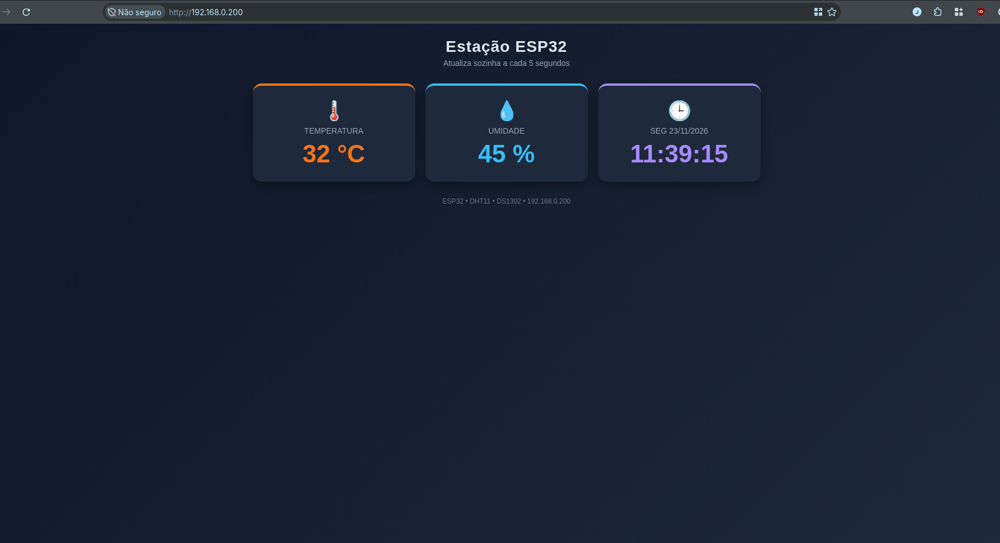

# ESP32 com MicroPython — do básico ao avançado

Trilha prática de **IoT e Sistemas Embarcados** com o ESP32 e MicroPython: do primeiro LED piscando até uma **estação web** com sensor, relógio de tempo real e sincronização de hora pela internet.

Cada projeto tem sua própria pasta com **código comentado**, **ligações**, **fotos da montagem** e o **passo a passo** do desenvolvimento.

  

---

## Destaque: Estação Web (Projeto 029)

Servidor web rodando **no próprio ESP32**, com temperatura e umidade (DHT11), data e hora num RTC (DS1302) acertado via **NTP**, e página **responsiva** para PC e celular.

➡️ [Ver o projeto completo](projeto029-estacao-web/)

## Hardware e ferramentas

| Item | Detalhe |
|---|---|
| Placa | ESP32 DevKit (ESP-WROOM-32, 30 pinos) |
| Firmware | MicroPython 1.29 |
| IDE | Thonny |
| Simulação | Wokwi |
| Terminal | `mpremote` (Linux) |

## Projetos

| Nº | Projeto | Conceitos | Status |
|---|---|---|---|
| 001 | LED | GPIO, saída digital | Em breve |
| 002 | Semáforo | Sequência de saídas, temporização | Em breve |
| 003 | Buzzer | Som com saída digital | Em breve |
| 004 | Botão | Entrada digital, pull-up, debounce | Em breve |
| 005 | Potenciômetro | ADC, leitura analógica | Em breve |
| 006 | LDR | Sensor de luz, média de leituras | Em breve |
| 007 | LED dimmer | PWM | Em breve |
| 008 | LED RGB | PWM em 3 canais | Em breve |
| 009 | Buzzer música | Frequência com PWM | Em breve |
| 010 | Servo | PWM a 50 Hz | Em breve |
| 011 | DHT11 | Temperatura e umidade | Em breve |
| 012 | LM35 | Sensor analógico, calibração | Em breve |
| 013 | PIR alarme | Sensor de presença | Em breve |
| 014 | Inclinação | Sensor de inclinação | Em breve |
| 015 | Palmas | Sensor de som | Em breve |
| 016 | Chama e água | Sensores digitais e analógicos | Em breve |
| 017 | Display 7 segmentos | Mapeamento de segmentos | Em breve |
| 018 | Display 4 dígitos | Multiplexação | Em breve |
| 019 | 74HC595 | Registrador de deslocamento | Em breve |
| 020 | Matriz 8x8 | Multiplexação em matriz | Em breve |
| 021 | LCD I2C | Driver próprio, I2C | Em breve |
| 022 | Teclado 4x4 | Varredura de matriz | Em breve |
| 023 | Joystick | ADC em 2 eixos, zona morta | Em breve |
| 024 | Controle IR | Interrupções, decodificação de sinal | Em breve |
| 025 | Relógio RTC | DS1302, BCD | Em breve |
| 026 | Motor de passo | 28BYJ-48, driver ULN2003 | Em breve |
| 027 | RFID | Leitor RC522 | Planejado |
| 028 | Fechadura completa | RFID + teclado + LCD + relé | Planejado |
| 029 | [Estação web](projeto029-estacao-web/) | Wi-Fi, servidor HTTP, NTP, CSS | ✅ Publicado |

## Bibliotecas próprias

| Arquivo | Descrição |
|---|---|
| [`bibliotecas/lcd_i2c.py`](bibliotecas/lcd_i2c.py) | Driver do LCD 16x2 via I2C (PCF8574), modo 4 bits |
| [`bibliotecas/ds1302.py`](bibliotecas/ds1302.py) | Driver do relógio DS1302 (protocolo de 3 fios, BCD) |

## Configuração

Os projetos que usam Wi-Fi leem as credenciais de um arquivo `config.py` **dentro da placa**, que **não é versionado**.

1. Copie [`config.exemplo.py`](config.exemplo.py) para `config.py`.
2. Preencha com os dados da sua rede.
3. Salve o `config.py` **dentro da placa** (Thonny: *Salvar como → Dispositivo MicroPython*).

## Autor

**Jussielson** — Analista e Desenvolvedor de Sistemas

[GitHub](https://github.com/JussielsonGsilva)
